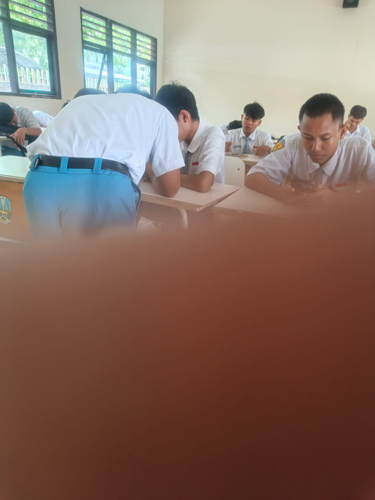

# Siswa Kelas X TEI 2

Saya adalah seorang siswa kelas X jurusan Teknik Elektronika Industri (TEI 2) di SMK Negeri 2 Lamongan yang memiliki ketertarikan besar pada bidang elektronika, sistem kontrol industri, mikrokontroler, dan pemanfaatan teknologi digital.

## Keahlian

- Dasar Elektronika & Perancangan Rangkaian PCB
- Pembacaan Skematik Rangkaian & Gambar Teknik Elektronika
- Penggunaan Alat Ukur Elektronika (Multimeter & Osiloskop)
- Keselamatan dan Kesehatan Kerja (K3) Elektronika

## Proyek & Praktikum Unggulan

- **Portofolio Web dengan GitHub Pages:** Tugas praktik membuat halaman portofolio online menggunakan GitHub untuk mempelajari penerapan teknologi Cloud Computing.
- 
## Tugas Formulir Umpan Balik / Absensi

- [Isi Google Formulir di Sini]([https://forms.gle](https://forms.gle/4hTGgfibAnQ2hHud7))
- 
## Mata Pelajaran

- **Mapel:** Koding dan Kecerdasan Artifisal
- **Pengajar:** Pak Agus Halui

